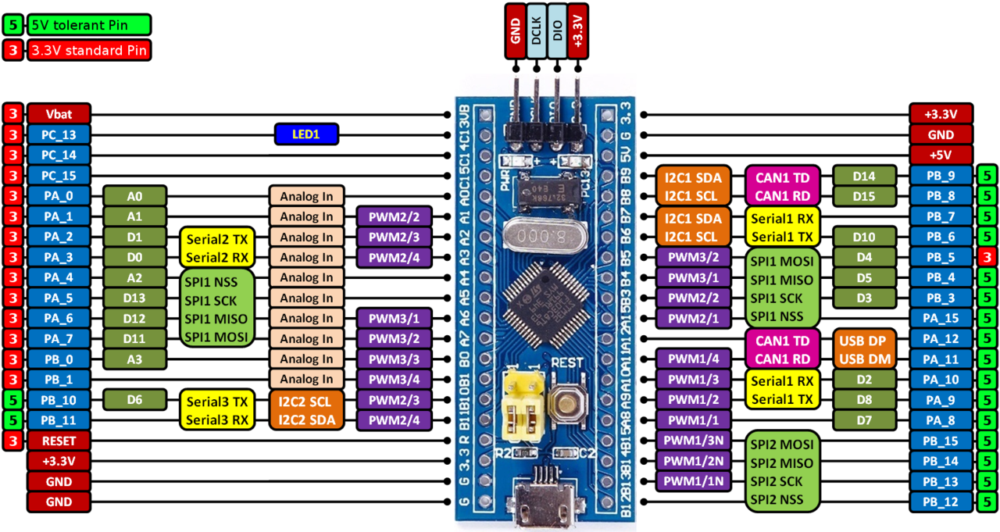

# STM32 Blue Pill USB Bootloader

This guide walks through creating a new STM32F103 ("Blue Pill") project from scratch, building it in VS Code, and getting the resulting image onto the board — either over USB through the HID bootloader that lives on the chip, or over ST-Link.

The first part explains how the arrangement actually works. Almost every step that looks strange later — the flash offset, the linker sizes, the vector-table check, the reason `--erase-all` is off limits — falls straight out of that explanation, so it is worth reading once before touching CubeMX.

## Fundamentals: how the setup works

### The chip and its flash

An STM32F103 has its program memory in internal flash starting at address `0x08000000`. After reset the CPU fetches its initial stack pointer and reset handler from the very start of that region, so whatever sits at `0x08000000` is what runs first. There is no operating system and no filesystem in between: the hardware simply starts executing at the beginning of flash.

### What a bootloader is

A bootloader is a small program placed at the start of flash that runs before anything else. At reset it decides what to do next: either hand control to the application already stored higher up in flash, or enter a mode where it accepts a new application image and writes it into flash itself.

This project uses a USB HID bootloader. The advantage is the USB HID class: the host operating system already has a driver for it, so no custom driver, no virtual COM port, and no ST-Link are needed to program the board. The host-side tool sends the raw image over that HID channel and the bootloader writes it. The bootloader only has to be installed once, with ST-Link.

### Why the application starts at 0x08000800

The bootloader occupies the first 2 KB of flash. To stop the application from being linked on top of it, the application's flash region is redefined to begin at `0x08000800` with a reduced length. The image is then built for that address, and the two never overlap.

This is also why a full chip erase is dangerous on a board that relies on the bootloader: it removes the bootloader as well as the application, and nothing will answer on USB until the bootloader is written back.

### The vector table and VTOR

The first bytes of any Cortex-M image are the vector table. Its first two entries are the two values the CPU reads at reset:

- offset `0x00` — the initial main stack pointer, which should point to the top of RAM
- offset `0x04` — the address of the reset handler, which in Thumb code always ends in an odd digit

When the application does not sit at `0x08000000`, the core has to be told where its vector table now lives, otherwise every interrupt and exception continues to be dispatched through the bootloader's table and the program crashes as soon as anything fires. That relocation is done by writing the CPU's vector-table offset register at startup.

The same reasoning is why interrupt enabling is moved later in the startup sequence: nothing should be able to raise an interrupt before the vector table has been pointed at the correct place.

### Why the linker script matters

The linker script describes the memory regions the program is built for, and the initial stack pointer is taken from the top of the RAM region described there. If the described RAM is larger than the RAM that physically exists, the stack starts beyond the end of real memory and the first push to the stack faults. The sizes in the linker script therefore have to match the actual device, not the part number on the packaging.

### `.elf` and `.bin`

The `.elf` is the linked executable: code, data and debug information, used by the debugger. The `.bin` is a flat image with no metadata, meant to be written into flash at a chosen address. The bootloader writes the `.bin`.

### What happens during a USB flash

The board is put into bootloader mode with a jumper and a reset. The bootloader starts instead of the application and presents itself on USB as an HID device. The host tool sends the `.bin`, the bootloader writes it into flash, and after a reset the application runs. Windows sometimes reports the device as having malfunctioned partway through the swap; that is expected during the transition and does not indicate a failed write. The LED is the reliable indicator of state.

## Repository contents

[Download USBboot.zip](https://github.com/iprince10/STM32_BluePill_USB-BOOTLOADER/raw/main/USBboot.zip)

| Item | What it is | Path after extraction |
| --- | --- | --- |
| `USBboot.zip` | The complete Windows-side toolkit in one download: the host tool and the prebuilt bootloader images. | — |
| `USBboot/hid_flash/` | The host-side tool, `hid-flash.exe`, which talks to the bootloader over USB HID and pushes the image into flash. | `D:\USBboot\hid_flash` |
| `USBboot/stm32_binaries/` | Prebuilt bootloader images, including `hid_generic_pc13.bin`. | `D:\USBboot\stm32_binaries` |
| `README.md` | This document. | — |

Extract `USBboot.zip` so that the `USBboot` folder sits at `D:\USBboot`. The two folders inside it then land at `D:\USBboot\hid_flash` and `D:\USBboot\stm32_binaries`, which is the location every command in this guide expects, so nothing needs editing. If you keep them elsewhere, adjust the paths accordingly.

`hid_generic_pc13.bin` is the HID bootloader for low/medium-density STM32F103 parts, with the LED on PC13. It is the file written with ST-Link when installing or restoring the bootloader.

## Hardware



*Pinout of the STM32F103C8T6 board, including the pin labels, the onboard LED on PC13, and the jumper block.*

### ST-Link wiring

### ST-Link wiring

| ST-Link | Board |
| --- | --- |
| SWCLK | PA14 |
| SWDIO | PA13 |
| GND | GND |
| 3V3 | 3V3 |
| RST | R (recommended) |

### Pins and the onboard LED

The onboard LED is on PC13 and is active-low, so a low level turns it on.

Pins to avoid when assigning new peripherals: PA13 and PA14 (SWD), PB2 (BOOT1), PA11 and PA12 (USB, on the bootloader board), and PA9 and PA10 (UART rescue).

### Jumper positions

One jumper, the one next to the reset button, selects the USB bootloader. The other stays at 0 at all times. Both are read only at reset, so press reset after moving one.

| Action | Jumper (next to reset) | Other jumper | Connected |
| --- | --- | --- | --- |
| Run app | 0 | 0 | USB (power) |
| Flash over USB | 1 | 0 | USB |
| Debug with ST-Link | 0 | 0 | ST-Link |
| Rescue via CP2102 | 0 | 1 | CP2102 |

## Software prerequisites

- VS Code with the STM32CubeIDE extension, and STM32CubeMX.
- STM32CubeProgrammer, for writing the bootloader or rescuing a board.
- `USBboot.zip` from this repository, extracted to `D:\USBboot` (see Repository contents).

## Reading the placeholders

Anything in angle brackets is a blank to fill in with your own value, not text to type:

| Placeholder | Meaning | Example |
| --- | --- | --- |
| `<project>` | The project or binary name | `BluePill_USB_Blink` |
| `<path>` | A real folder path | `C:\Users\Prince Jha\STM32_BluePill` |

PowerShell treats `<` and `>` as special characters, so pasting a placeholder verbatim gives:

```
Resolve-Path : Illegal characters in path.
```

That is not a broken command, it is an unfilled blank. Either replace the placeholder, or use the auto-detecting version of the command given under "Building and verifying the image", which needs no editing at all.

## Installing the bootloader

This is the first thing to do to a new board, and the one operation that needs an ST-Link. Everything after it can be done over USB. Repeat it whenever the bootloader has been erased, or whenever the board stops answering on USB.

Before starting: jumpers 0/0, ST-Link wired as in the table above, board connected and powered.

1. Open STM32CubeProgrammer.
2. In the interface dropdown at the top right, select ST-LINK and press Connect.
3. If more than one probe is attached, open the ST-Link configuration first and select the correct one by serial number.
4. Switch to the Erasing & Programming view.
5. Press Full chip erase and confirm. This wipes the entire flash, so both the bootloader and any application are removed.
6. Still in that view, set the file path to the bootloader image: `D:\USBboot\stm32_binaries\hid_generic_pc13.bin`.
7. Set the start address to `0x08000000`.
8. Tick Verify programming. Ticking Run after programming is optional.
9. Press Start programming and wait for it to report success.
10. Press reset on the board. The LED should now blink fast, which is the bootloader waiting for an image over USB. That confirms it is installed and working.

Two cautions. A full chip erase removes the application as well as the bootloader, so do not reach for it just to update an application; the USB route replaces the application without touching the bootloader. And when debugging over ST-Link on a board that relies on the bootloader, never use an erase-all option, for the same reason: it takes the bootloader with it.

Button labels differ slightly between versions of CubeProgrammer. The sequence is always the same: connect over ST-Link, full chip erase, then write the image at `0x08000000` with verification enabled.

## Creating a new project in CubeMX

1. STM32Cube panel → Launch STM32CubeMX → Access to MCU Selector.
2. MCU: STM32F103CBTx for the 128 KB board, STM32F103C8Tx for the clone.
3. RCC → HSE: Crystal/Ceramic Resonator.
4. SYS → Debug: Serial Wire.
5. Clock Configuration: type 72 into HCLK and press Enter.
6. Set your pins, for example PC13 as GPIO_Output with the label LED. Do not enable the USB peripheral.
7. Project Manager: name and location, toolchain CMake, then Generate Code.

## Opening the project in VS Code

File → Open Folder, then accept "Configure as STM32Cube project" (or use the STM32Cube panel → Setup STM32Cube project(s)), choose the device, then Configure with the Debug preset.

## Board-specific edits

### Clone with plain ST-Link

In the `_FLASH.ld` file, set the real sizes (`FLASH` 32K, `RAM` 6K). Otherwise the stack points outside real RAM and you get a HardFault right at start.

### 128 KB board with the USB bootloader

```c
/* _FLASH.ld */
MEMORY
{
  RAM    (xrw) : ORIGIN = 0x20000000, LENGTH = 20K
  FLASH  (rx)  : ORIGIN = 0x08000800, LENGTH = 126K
}
```

```c
/* main.c */
/* USER CODE BEGIN 1 */
SCB->VTOR = FLASH_BASE | 0x800U;
/* USER CODE END 1 */
...
/* USER CODE BEGIN 2 */
__enable_irq();
/* USER CODE END 2 */
```

```cmake
# end of the top-level CMakeLists.txt
add_custom_command(TARGET ${CMAKE_PROJECT_NAME} POST_BUILD
    COMMAND ${CMAKE_OBJCOPY} -O binary $<TARGET_FILE:${CMAKE_PROJECT_NAME}> ${CMAKE_PROJECT_NAME}.bin
    COMMENT "Creating .bin")
```

## VS Code tasks

Create the folder `.vscode` in the project root and add `tasks.json` with the contents below. The file name comes from `${workspaceFolderBasename}`, so it fills itself in and nothing needs typing.

```json
{
  "version": "2.0.0",
  "tasks": [
    {
      "label": "Build",
      "type": "shell",
      "command": "cmake",
      "args": [
        "--build",
        "${workspaceFolder}/build/Debug"
      ],
      "group": {
        "kind": "build",
        "isDefault": true
      },
      "problemMatcher": [
        "$gcc"
      ]
    },
    {
      "label": "Flash over USB",
      "type": "shell",
      "command": "D:\\USBboot\\hid_flash\\hid-flash.exe",
      "args": [
        "${workspaceFolder}\\build\\Debug\\${workspaceFolderBasename}.bin",
        "COM99"
      ],
      "dependsOn": "Build",
      "problemMatcher": []
    },
    {
      "label": "Check vector table",
      "type": "shell",
      "command": "powershell",
      "args": [
        "-NoProfile",
        "-Command",
        "$f = (Get-ChildItem '${workspaceFolder}/build/Debug/*.bin' | Select-Object -First 1).FullName; $b = [System.IO.File]::ReadAllBytes($f); '{0:X8}  {1:X8}' -f [BitConverter]::ToUInt32($b,0), [BitConverter]::ToUInt32($b,4)"
      ],
      "dependsOn": "Build",
      "problemMatcher": []
    }
  ]
}
```

Build is the default build task, so Ctrl+Shift+B runs it. Flash over USB builds first and then invokes the tool with the dummy `COM99` argument this version of it requires; the board must already be in bootloader mode. Check vector table is the sanity check described below, wired in as a task so it needs no editing. If the binary or build folder is named differently, adjust the paths in the `args` arrays only.

## Building and verifying the image

Build, then in the terminal:

```powershell
$b = [System.IO.File]::ReadAllBytes((Resolve-Path build\Debug\<project>.bin).Path)
"{0:X8}  {1:X8}" -f [BitConverter]::ToUInt32($b,0), [BitConverter]::ToUInt32($b,4)
```

With the placeholder filled in, that becomes:

```powershell
$b = [System.IO.File]::ReadAllBytes((Resolve-Path build\Debug\BluePill_USB_Blink.bin).Path)
```

Version that needs no editing. This one picks up whichever `.bin` is in `build\Debug`, so it works in any project:

```powershell
$f = (Get-ChildItem build\Debug\*.bin | Select-Object -First 1).FullName
$b = [System.IO.File]::ReadAllBytes($f)
"{0:X8}  {1:X8}" -f [BitConverter]::ToUInt32($b,0), [BitConverter]::ToUInt32($b,4)
```

Run it from the project folder. Expect the first value to be `20005000` and the second something like `0800xxxx`, at least `08000800`, ending in an odd digit.

The check reads the first two 32-bit words of the image, which are the first two entries of the vector table:

| Word | Offset | Meaning | Expected |
| --- | --- | --- | --- |
| 1 | 0x00 | Initial main stack pointer | `20005000` |
| 2 | 0x04 | Reset handler address | `0800xxxx`, at least `08000800`, odd |

## Flashing

### Over ST-Link, for debugging

Jumpers 0/0, wire the ST-Link, press F5. Never add `--erase-all` on the bootloader board.

### Over USB, without an ST-Link

1. Move the jumper next to reset to 1, then press reset. The LED blinks fast.
2. Run the Flash over USB task, or run the command manually:

```powershell
& "D:\USBboot\hid_flash\hid-flash.exe" "C:\Users\Prince Jha\STM32_BluePill\BluePill_USB_Blink\build\Debug\BluePill_USB_Blink.bin" COM99
```

The `COM99` is a dummy that this version needs. The VS Code task uses `${workspaceFolderBasename}` for the file name, so it fills itself in and you don't type anything.

3. Move the jumper back to 0 and press reset.

### Rescue over CP2102

CP2102 TXD to PA10, RXD to PA9, GND, 5V. BOOT0 = 1, press reset. In CubeProgrammer switch to UART (Even parity, 115200). Set BOOT0 back to 0 afterward.

### Reinstalling the bootloader

With a working ST-Link, run Full chip erase, then write `hid_generic_pc13.bin` from the `stm32_binaries` folder at `0x08000000` with Verify programming.

## Troubleshooting

| Symptom | Likely cause | Fix |
| --- | --- | --- |
| `Illegal characters in path` | Unfilled `<placeholder>` | Replace it, or use the auto-detecting command |
| `Cannot find path ... because it does not exist` | Wrong file name, or the build was not run | Check `build\Debug\*.bin` exists; build first |
| HardFault immediately at start | Linker sizes don't match real silicon | Correct the FLASH and RAM sizes for the board |
| Nothing runs after a USB flash | Vector table not relocated, or jumper left at 1 | Set the vector table offset, jumpers back to 0/0, reset |
| Vector table check shows `08000000` | Image linked for the wrong flash origin | Use `0x08000800` as the flash origin on the bootloader board |
| Second word ends in an even digit | Not a valid Thumb address, or a damaged image | Rebuild; something corrupted the entry point |
| Upload reports the device as malfunctioning | Expected during the USB mode swap | Harmless; confirm state from the LED pattern |
| Board unresponsive after a bad flash | The application overwrote or replaced the bootloader | Reinstall the bootloader, or use the CP2102 rescue |

## Notes

- After CubeMX regenerates code, re-check the `.ld` file. Keep your own code inside the `USER CODE` markers.
- The LED tells you which program is running: a fast blink is the bootloader, your own pattern is the application.
- Check any new peripheral pin against the list of pins to avoid.
- When more than one ST-Link is attached, pick the right one by serial number in CubeProgrammer.
- A working project folder can be copied and renamed to serve as a template for the next one.
